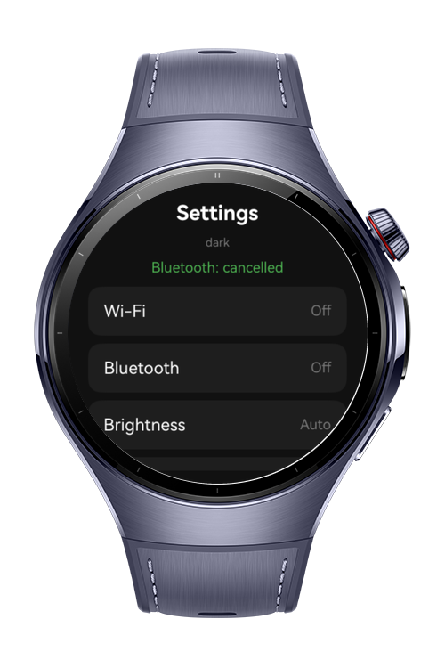
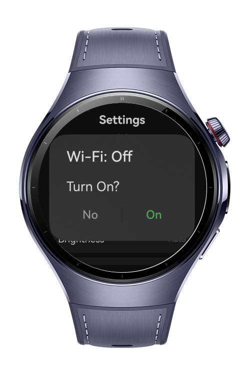
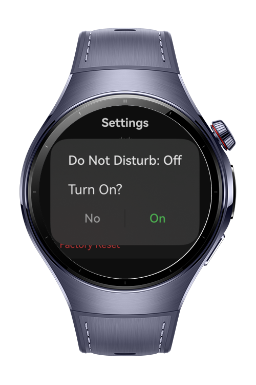
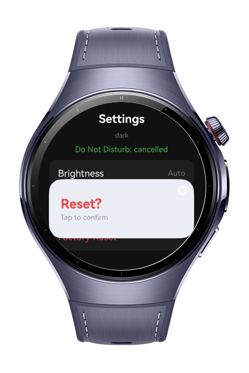

> **Note:** To access all shared projects, get information about environment setup, and view other guides, please visit [Explore-In-HMOS Index](https://github.com/Explore-In-HMOS/hmos-index).

# How to Build Dialog System Config

The `how-to-build-dialog-system-config` codelab demonstrates dialog-driven confirmation workflows for settings changes on a HarmonyOS wearable: a settings list rendered from a data array with `Repeat`, standard confirmations through `promptAction.showDialog` with customized `ShowDialogOptions` buttons, a full-screen `InterstitialDialogAction` guarding a destructive factory-reset operation, and the built-in `colorMode` environment variable adapting the UI to the system color mode.

# Preview

<div>
  
  
  
  
</div>

# Use Cases

- **Data-Driven List Rendering**: Render the settings list from a typed data array using `Repeat<SettingItem>` with `.each()` and `.key()`, where the key encodes `name:value` so a value change re-renders exactly the changed row.
- **Standard Confirmation Dialogs**: Open `promptAction.showDialog` with a title, a message, and a two-button array from `ShowDialogOptions`, and drive the apply/cancel decision from the resolved button index.
- **Interstitial Destructive Confirmation**: Guard the factory-reset entry with a full-screen `InterstitialDialogAction`, where tapping the dialog body confirms (`onDialogClick`) and the close button cancels (`onDialogClose`).
- **State-Observed Toggling**: Apply an On/Off change by replacing the array element with a new `SettingItem` instance in a `@State` array, so ArkUI state observation picks up the mutation and `Repeat` re-renders.
- **Built-in Environment Variables**: Register `colorMode` with `Environment.envProp` at ability creation and read it through `@StorageProp('colorMode')` to display the current system color mode.
- **Round-Screen Layout Care**: Keep the last list row fully visible above the round screen's bottom curve with `contentEndOffset`, and keep dialog button labels short to avoid truncation.

# Tech Stack

- **Languages**: ArkTS / ArkUI
- **Frameworks**: HarmonyOS SDK 6.0.1(21)
- **Tools**: DevEco Studio, Hvigor
- **Libraries**:
    - `@kit.ArkUI`
    - `@kit.BasicServicesKit`

# Directory Structure
```
entry/src/main/
|---ets/
|   |---entryability/
|   |   |---EntryAbility.ets
|   |---pages/
|   |   |---Index.ets
|   |---models/
|   |   |---SettingItem.ets
|   |---helpers/
|   |   |---SettingsHelper.ets
|   |   |---DialogHelper.ets
|---resources/
|   |---base/
|   |   |---element/
|   |   |   |---color.json
|   |   |   |---string.json
|   |---dark/
|   |   |---element/
|   |   |   |---color.json
|---module.json5
```

# Constraints and Restrictions

- **Button Label Truncation**: On the round wearable screen, `showDialog` button labels truncate when long ("Cancel" renders as "C..."); keep button text short ("Yes"/"No").
- **Interstitial Text Length**: `InterstitialDialogAction` renders with a system-defined layout; keep the title and subtitle short for the content to display fully on the round screen.
- **Environment Variable Registration**: Built-in environment variables must be registered with `Environment.envProp` (in `EntryAbility.onCreate`) before `@StorageProp` reads them; without registration they stay at their local defaults. `Environment` is available globally and is not exported by `@kit.ArkUI`.
- **languageCode Availability**: The `languageCode` environment variable did not populate on the physical wearable used for testing and is excluded from the UI; only `colorMode` is displayed.
- **PiP Not Supported**: The PiP feature is supported on phones, PCs/2-in-1 devices, and tablets, but is unavailable on all other devices, so `PiPWindow` is out of scope on wearables.

## Supported Devices

- Huawei Watch 5

# License

`how-to-build-dialog-system-config` is distributed under the terms of the MIT License.
See the [LICENSE](LICENSE) for more information.